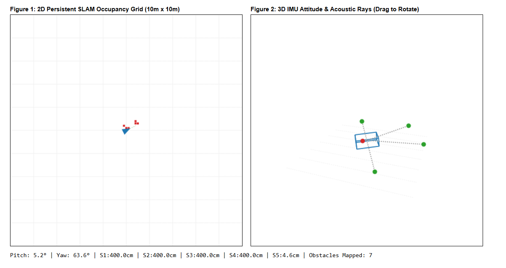

# NETRA

Navigational Echo Target Recovery Array for zero-visibility underwater search and rescue operations.



---

## Pin Configuration

| Zone | Label | Sonar Trigger | Sonar Echo | Haptic Servo |
| :--- | :--- | :--- | :--- | :--- |
| Left Shoulder | S1 | GPIO 12 | GPIO 36 | GPIO 17 |
| Left Chest | S2 | GPIO 14 | GPIO 39 | GPIO 4 |
| Center Chest | S3 | GPIO 25 | GPIO 32 | GPIO 16 |
| Right Chest | S4 | GPIO 27 | GPIO 34 | GPIO 5 |
| Right Shoulder / Back | S5 | GPIO 26 | GPIO 35 | GPIO 18 |

- **Inter-ESP UART Link**: ESP1 TX (GPIO 17) → ESP2 RX (GPIO 19) + Common GND
- **IMU Interface**: MPU6050 via I2C (SDA GPIO 21, SCL GPIO 22)

---

---

## Launch

```bash
cd NETRA_DASHBOARD
python main.py
```
Open `http://localhost:8080` in your web browser.
